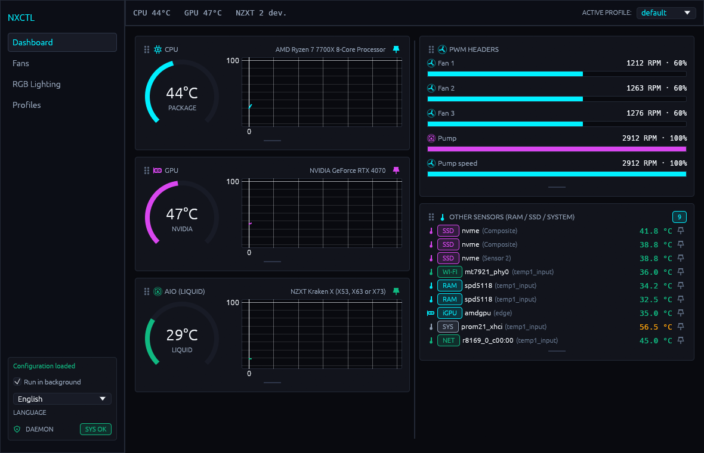
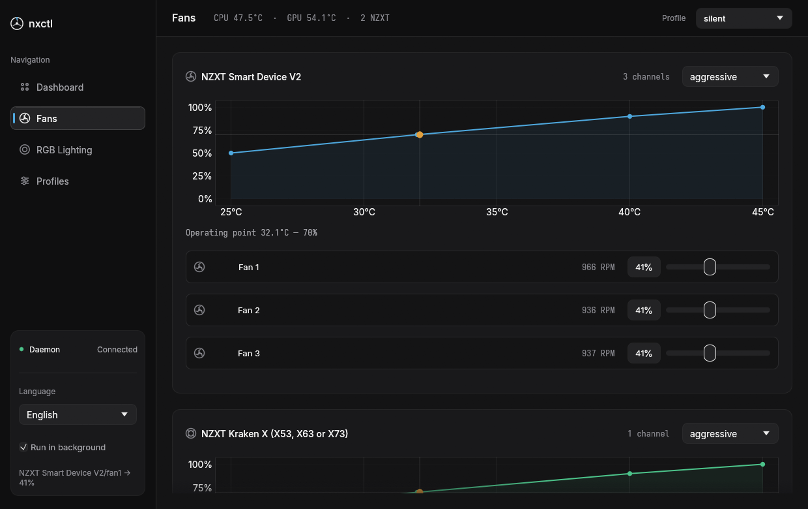
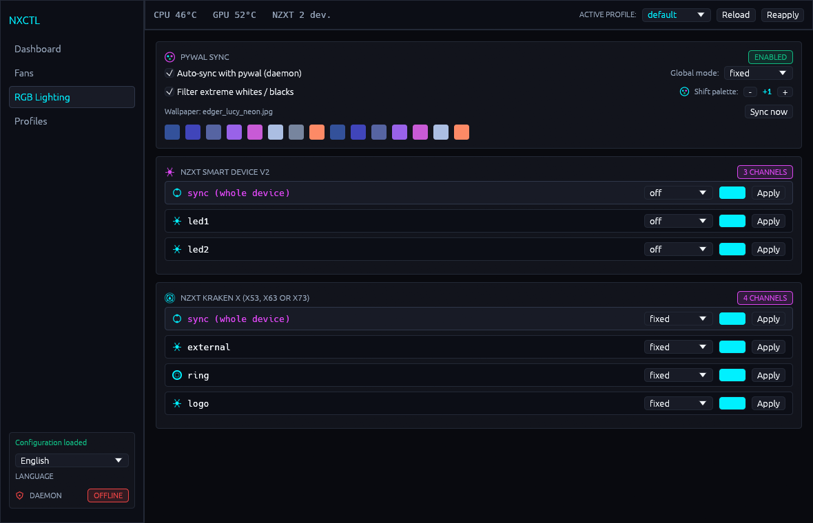
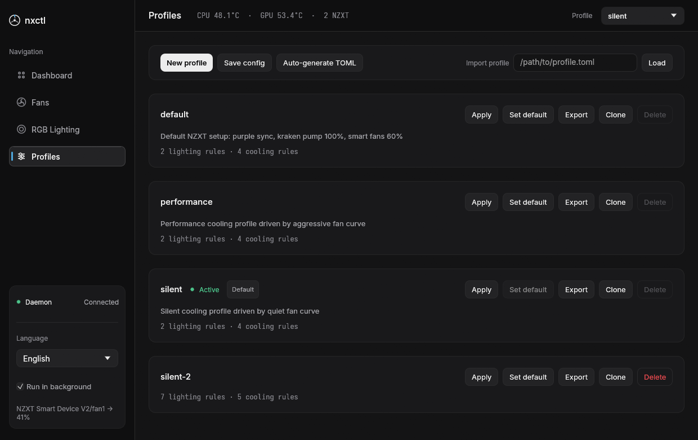

# nxctl

Open-source Linux alternative to NZXT CAM, built on top of [liquidctl](https://github.com/liquidctl/liquidctl).

- `nxctl-gui`: native desktop dashboard (`egui`/`eframe`) for live telemetry, fan curves, RGB lighting, pywal sync, and profile management.
- `nxctl`: CLI and interactive terminal UI (`nxctl tui`) for status, profiles, curves, and manual control.
- `nxctld`: background daemon that adjusts fans/pumps dynamically from temperature sensors (with hysteresis) and syncs `pywal` palettes.

## Desktop GUI (`nxctl-gui`)

Launch the desktop application with:

```sh
nxctl-gui [--lang es|en] [--view dashboard|fans|rgb|profiles] [--minimized|--tray] [--config PATH] [--socket PATH] [--dry-run]
```

- **Zero-config startup**: on first launch, `nxctl-gui` (as well as `nxctld` and `nxctl tui`) automatically creates `~/.config/nxctl/config.toml` with safe detected defaults if none exists, and starts `nxctld` automatically when the daemon socket is not yet running.
- **X11 System Tray & Background Mode**:
  - Starts with a crisp white tray icon (pass `--minimized` or `--tray` to launch hidden in the tray).
  - **Left-click** toggles window visibility, **scroll wheel up/down** cycles active profiles, and **right-click** opens a native **Open / Quit** context menu.
  - Enable **Run in background** in the bottom-left sidebar card (`close_to_tray = true` in `config.toml`) so closing the window hides it to the tray instead of exiting.

### Dashboard
Live radial gauges and rolling temperature history charts for CPU, GPU, and AIO coolant, PWM fan/pump headers, and secondary `hwmon` system sensors (NVMe, RAM, Wi-Fi, chipset, NIC):

- **Pin / Unpin**: click the pushpin icon on any card or sensor row (filled accent color when pinned, grey outline when unpinned) to promote or demote it.
- **Device Model Labels**: pinned cards display detected hardware model names (e.g. `AMD Ryzen 7 7700X 8-Core Processor`, `NVIDIA GeForce RTX 4070`, `NZXT Kraken X (X53, X63 or X73)`) to the left of the pin icon.
- **Move & Resize Layout**: drag cards by their `⋮⋮` handles to reorder panels or move them across columns, drag the vertical column splitter to resize left/right column widths, and drag the bottom resize handle on any card to adjust its height.



### Fans
Grouped per-device fan curve plots with live operating-point overlay and per-channel manual duty sliders.



### RGB Lighting
Per-device and per-channel RGB mode/color controls plus **Pywal Sync** with live wallpaper palette swatches, a **Saturate (vivid)** HSV chroma boost checkbox and `0%–100%` slider, palette offset controls, and automatic daemon synchronization.



### Profiles
Create, capture from current state, clone, edit, import/export portable `.toml` profile bundles, set the default profile, or click **Auto-generate TOML** to regenerate `config.toml` from currently detected hardware (preserving your `language` and `close_to_tray` preferences).



## Localization (English & Spanish)

All user-facing tools (`nxctl-gui`, `nxctl`, and `nxctl tui`) support **English (`en`)** and **Spanish (`es`)**:

- **Config file (`~/.config/nxctl/config.toml`)**: created automatically from detected hardware on first launch of `nxctld`, `nxctl-gui`, or `nxctl tui`; set `language = "en"` or `language = "es"` (defaults to `"es"` if omitted) and `close_to_tray = true` to hide to the system tray on close.
- **GUI**: choose **English** / **Español** directly from the **LANGUAGE** selector in the bottom-left sidebar card (saved automatically to `config.toml`), or start with `nxctl-gui --lang en`.
- **CLI**: pass `--lang en` or `--lang es` globally (for example, `nxctl --lang en sensors`), or set `NXCTL_LANG` / `LANG`.
- **TUI**: press `l` inside `nxctl tui` to toggle between English and Spanish live.

## Installation

### Package Repository (Recommended — Signed Updates via GitHub Pages)

Install `nxctl` and receive automatic signed updates through the central [`angelgnz/packages`](https://angelgnz.github.io/packages/) repository:

- **Ubuntu / Debian / Mint / Pop!_OS (`apt`)**:

  ```sh
  curl -fsSL https://angelgnz.github.io/packages/gpg.key | sudo gpg --dearmor -o /usr/share/keyrings/angelgnz-packages.gpg
  echo "deb [arch=amd64 signed-by=/usr/share/keyrings/angelgnz-packages.gpg] https://angelgnz.github.io/packages/apt stable main" | sudo tee /etc/apt/sources.list.d/angelgnz-packages.list
  sudo apt update && sudo apt install nxctl
  ```

- **Fedora Workstation (`dnf`)**:

  ```sh
  sudo curl -fsSL https://angelgnz.github.io/packages/rpm/angelgnz-packages.repo -o /etc/yum.repos.d/angelgnz-packages.repo
  sudo dnf install nxctl
  ```

- **Fedora Atomic / Silverblue / Kinoite / Bazzite (`rpm-ostree`)**:

  ```sh
  sudo curl -fsSL https://angelgnz.github.io/packages/rpm/angelgnz-packages.repo -o /etc/yum.repos.d/angelgnz-packages.repo
  rpm-ostree install nxctl
  sudo rpm-ostree apply-live --allow-replacement
  sudo udevadm control --reload-rules && sudo udevadm trigger -s hwmon
  systemctl --user enable --now nxctld
  ```

- **openSUSE Tumbleweed / Leap (`zypper`) & Aeon / MicroOS (`transactional-update`)**:

  ```sh
  sudo rpm --import https://angelgnz.github.io/packages/gpg.key
  sudo zypper ar -f https://angelgnz.github.io/packages/rpm angelgnz-packages
  sudo zypper refresh && sudo zypper in nxctl
  # Or on Aeon / MicroOS:
  sudo transactional-update pkg install nxctl
  ```

- **Arch Linux / EndeavourOS / CachyOS (`pacman`)**:

  ```sh
  curl -fsSL https://angelgnz.github.io/packages/gpg.key | sudo pacman-key --add -
  sudo pacman-key --lsign-key 44B0056D18E88F598404490A1ACBF949D4EB5BDD
  printf '\n[angelgnz]\nSigLevel = Required DatabaseOptional\nServer = https://angelgnz.github.io/packages/arch/$arch\n' | sudo tee -a /etc/pacman.conf
  sudo pacman -Syu nxctl
  ```

### Prebuilt Packages (GitHub Releases)

Download the appropriate package for your distribution from the [GitHub Releases](../../releases) page:

- **Arch Linux**:

  ```sh
  sudo pacman -U nxctl-*.pkg.tar.zst
  ```

  Or build locally from `packaging/arch/PKGBUILD`:

  ```sh
  cd packaging/arch && makepkg -si
  ```

- **Ubuntu / Debian**:

  ```sh
  sudo apt install ./nxctl_*_amd64.deb
  ```

- **Fedora Workstation**:

  ```sh
  sudo dnf install ./nxctl-*.x86_64.rpm
  ```

- **Fedora Atomic / Silverblue / Kinoite / Bazzite (`rpm-ostree`)**:

  ```sh
  rpm-ostree install ./nxctl-*.x86_64.rpm
  # Apply immediately without waiting for a reboot (or reboot normally):
  sudo rpm-ostree apply-live --allow-replacement
  sudo udevadm control --reload-rules && sudo udevadm trigger -s hwmon
  systemctl --user enable --now nxctld
  ```

  *(You can also build RPMs cleanly on Fedora/COPR using `packaging/rpm/nxctl.spec`.)*

- **openSUSE (Tumbleweed / Leap) & Aeon / MicroOS**:

  - Tumbleweed / Leap:
    ```sh
    sudo zypper in --allow-unsigned-rpm ./nxctl-*.x86_64.rpm
    ```
  - Aeon / MicroOS (`transactional-update`):
    ```sh
    sudo transactional-update pkg install ./nxctl-*.x86_64.rpm
    ```

  *(An OBS-compatible RPM spec is also provided at `packaging/rpm/nxctl.spec`.)*

- **NixOS & Nix Flakes (`flake.nix`)**:

  Run directly without installing:

  ```sh
  nix run github:angelgnz/nxctl
  ```

  Or add the flake module to `/etc/nixos/flake.nix` to install binaries, `liquidctl`, `udev` rules, and the `nxctld` user service declaratively:

  ```nix
  {
    inputs = {
      nixpkgs.url = "github:NixOS/nixpkgs/nixos-unstable";
      nxctl.url = "github:angelgnz/nxctl";
    };

    outputs = { nixpkgs, nxctl, ... }: {
      nixosConfigurations.myhost = nixpkgs.lib.nixosSystem {
        system = "x86_64-linux";
        modules = [
          nxctl.nixosModules.default
          { services.nxctl.enable = true; }
        ];
      };
    };
  }
  ```

- **AppImage (Universal Portable)**:

  Requires `liquidctl` and the `udev` rule ([contrib/72-nzxt-hwmon.rules](contrib/72-nzxt-hwmon.rules)) installed on the host for rootless fan/pump access:

  ```sh
  chmod +x nxctl-*-x86_64.AppImage
  ./nxctl-*-x86_64.AppImage              # launches nxctl-gui (with bundled nxctld)
  ./nxctl-*-x86_64.AppImage nxctl status # run CLI subcommands from the same bundle
  ```

### Build from Source

Requires `liquidctl` in `PATH` and Rust (2024 edition).

> **Note:** Building `nxctl-gui` (`eframe`/`egui`) requires X11/Wayland/OpenGL development headers. On Debian/Ubuntu, install:
> `sudo apt install pkg-config libxkbcommon-dev libwayland-dev libx11-dev libxcb-render0-dev libxcb-shape0-dev libxcb-xfixes0-dev libgl1-mesa-dev`

```sh
cargo build --release
sudo install -m755 target/release/{nxctl,nxctld,nxctl-gui} /usr/local/bin/
```

## CLI Usage

```sh
nxctl init [--detect] [--force]     # create initial config (--detect inspects your hardware)
nxctl init-devices [--match kraken]  # run `liquidctl initialize`
nxctl validate                       # validate config.toml without applying changes
nxctl status [--match kraken] [--json]
nxctl sensors [--json]               # list temperature sensors, hwmon PWM/fan channels, and NVIDIA GPUs
nxctl apply [PROFILE]                # defaults to config.default_profile
nxctl set color <MATCH> <CHANNEL> <MODE> <COLORS...>
nxctl set speed <MATCH> <CHANNEL> <0-100>
nxctl profiles list
nxctl profiles show <NAME>
nxctl curves list
nxctl curves show <NAME>
nxctl daemon status [--socket PATH] [--json]
nxctl daemon reload [--socket PATH]
nxctl daemon reapply [--socket PATH]
nxctl daemon profile <NAME> [--socket PATH]
nxctl pywal [--apply] [--json] [--path PATH] [--saturate VALUE] # inspect or apply pywal colors
nxctl tui [--socket PATH] [--interval SECS]
```

Global flags: `--config <PATH>`, `--dry-run`, `--lang <es|en>`, `-v/--verbose`.

### `hwmon` (CPU/GPU) and NVIDIA (`nvidia-smi`) Temperature Sensors

Use `nxctl sensors` to discover system thermal sensors (`/sys/class/hwmon`) and NVIDIA GPUs (via `nvidia-smi`):

```sh
nxctl sensors
nxctl sensors --json
```

To use an `hwmon` sensor (such as CPU or AMD/Intel GPU) in `config.toml`, specify `hwmon` (chip name such as `k10temp` or `amdgpu`, or directory `hwmon0`) and an optional `label`:

```toml
# Global sensor for the nxctld daemon:
[daemon.temp_sensor]
hwmon = "k10temp"
label = "Tctl"

# Or per cooling rule inside a profile:
[[profiles.performance.cooling]]
match_device = "smart"
channel = "fan1"
target = { curve = "aggressive", sensor = { hwmon = "k10temp", label = "Tctl" } }
```

To use an NVIDIA GPU as a temperature sensor (requires `nvidia-smi`), set `nvidia = true` and an optional `gpu` index (defaults to `0` when omitted):

```toml
# Global sensor for the nxctld daemon:
[daemon.temp_sensor]
nvidia = true
gpu = 0

# Or per cooling rule inside a profile:
[[profiles.performance.cooling]]
match_device = "smart"
channel = "fan2"
target = { curve = "aggressive", sensor = { nvidia = true, gpu = 0 } }
```

### Multi-Hardware Support (`hwmon` PWM, NVIDIA, and OpenRGB)

- **Initial auto-detection (`nxctl init --detect`)**: builds `config.toml` by inspecting `liquidctl` devices (NZXT, Corsair, Aquacomputer, EVGA, etc.), `hwmon` PWM channels, and NVIDIA GPUs, generating `default`, `silent`, `dynamic`, and `performance` profiles (with curve thresholds tuned for liquid vs. CPU/GPU sensors).
- **`dynamic` profile and curve**: stays flat and quiet up to the thermal knee (`35 °C` for liquid / `62 °C` for CPU/GPU) and ramps aggressively above it (`100%` with hysteresis bypass when rising to max duty).
- **Motherboard or AMD GPU fans (`hwmon` PWM)**: use `match_device = "hwmon:<chip>"` (or `hwmon0`) and `channel = "pwm1"` / `"fan1"` in `config.toml` or via `nxctl set speed hwmon:nct6775 pwm1 60`. Requires write access to `/sys/class/hwmon/hwmon*/pwm*`.
- **NVIDIA fans (`nvidia-settings`)**: use `match_device = "nvidia"` (or `"nvidia:0"`) and `channel = "fan0"` / `"fan"` to control fan duty via `nvidia-settings`.
- **Generic lighting (`openrgb`)**: use `match_device = "openrgb"` (or `"openrgb:0"`) in `lighting` rules or run `nxctl set color openrgb sync static 7400b8` to delegate to the OpenRGB CLI.

### Pywal Synchronization (`wal`)

`nxctl`, `nxctld`, and `nxctl-gui` can read the palette generated by [pywal](https://github.com/dylanaraps/pywal) (`~/.cache/wal/colors.json`) to match RGB lighting to your current wallpaper.

#### CLI inspection and application
```sh
# Inspect colors from the current pywal palette:
nxctl pywal

# Output the palette as JSON:
nxctl pywal --json

# Immediately apply the palette with vivid HSV saturation boost (0.0..1.0 or 0..100):
nxctl pywal --apply --saturate 0.5

# Specify a custom colors.json path:
nxctl pywal --apply --path /path/to/colors.json
```

#### In `config.toml` (automatic sync in `nxctld`)
```toml
# Optional top-level preferences
language = "en"
close_to_tray = true

[pywal]
enabled = true
# Optional path to colors.json (defaults to ~/.cache/wal/colors.json)
# colors_path = "/home/user/.cache/wal/colors.json"
# Vivid HSV saturation boost for chromatic swatches (0.0..1.0 or 0..100; near-neutral greys stay untouched)
saturate = 0.5

# Optional custom device/channel color mappings:
# If targets is empty, applies color4 (or color1) in 'fixed' mode to the 'sync' channel of all detected devices.
[[pywal.targets]]
match_device = "kraken"
channel = "sync"
color_key = "color4"
mode = "fixed"

[[pywal.targets]]
match_device = "smart"
channel = "led"
color_key = "color2"
mode = "fixed"
```

When `pywal.enabled = true`, `nxctld` watches `colors.json` modification times and updates devices automatically without restarting the service. Using `saturate` (`0.0..1.0` or `0..100`, CLI `--saturate`, GUI slider, or TUI `v` key) boosts HSV saturation and vibrance of chromatic pywal swatches for vivid LED output while preserving near-neutral blacks, greys, and whites.

In `nxctl-gui`, the **RGB Lighting** view includes a **Pywal Sync** card to toggle automatic synchronization, filter near-black/white swatches, boost vividness with **Saturate (vivid)** (`0%–100%`), shift the palette offset, click any swatch to apply it globally, or trigger a manual sync.

## Rootless Permissions (`udev`)

Kernel drivers (`nzxt_kraken3`, `nzxt-smart2`) expose fan/pump channels via `hwmon` (`pwm*`). To control fans and pumps without `sudo`, install the `udev` rule:

```sh
sudo cp contrib/72-nzxt-hwmon.rules /etc/udev/rules.d/
sudo udevadm control --reload-rules && sudo udevadm trigger -s hwmon
```

## `nxctld` Service

### Recommended setup (user service, no `sudo`)

```sh
nxctld --once --dry-run -v               # test a single tick with no hardware changes
nxctld --init-devices --once --dry-run   # initialize devices before applying profile
mkdir -p ~/.config/systemd/user
cp contrib/nxctld-user.service ~/.config/systemd/user/nxctld.service
systemctl --user enable --now nxctld
systemctl --user reload nxctld           # reload ~/.config/nxctl/config.toml via SIGHUP
```

### System-wide setup

```sh
sudo mkdir -p /etc/nxctl && sudo cp ~/.config/nxctl/config.toml /etc/nxctl/config.toml
sudo cp contrib/nxctld.service /etc/systemd/system/
sudo systemctl enable --now nxctld
sudo systemctl reload nxctld             # reload config.toml via SIGHUP
```

You can also reload, reapply, or switch profiles at runtime via Unix socket IPC:

```sh
nxctl daemon status
nxctl daemon reload
nxctl daemon reapply
nxctl daemon profile performance
```

### Suspend & Resume

On resume from suspend or hibernation, `nxctld` detects the wall-clock jump and reapplies the active profile (`daemon.reapply_on_resume = true` by default in `config.toml`). If your USB devices require re-initialization after wake, set `daemon.init_on_resume = true` in `config.toml` or pass `--init-on-resume` to `nxctld`.

You can also trigger re-application manually or from system hooks:
- Via IPC: `nxctl daemon reapply [--socket PATH]`
- Via `SIGUSR1`: `pkill -USR1 -x nxctld`
- Optional `systemd-sleep` hook (useful for immediate re-application on wake):

```sh
sudo install -m755 contrib/nxctl-sleep /usr/lib/systemd/system-sleep/nxctl-sleep
```

Adjust the `--config` path in the system unit to match your installation.

## Interactive TUI

```sh
nxctl tui [--socket PATH] [--interval SECS]
```

Keybindings: `1`–`4` / `PageUp` / `PageDown` switch tabs · `q`/`Esc`/`Ctrl+C` quit · `↑`/`↓` or `j`/`k` navigate · `Enter`/`a` apply profile or color · `f` pin/unpin sensor (Dashboard) · `r` reload/refresh · `p` reapply active profile · `Tab` switch section focus · `c` cycle curve (Fans) or clone profile (Profiles) · `v` cycle Pywal vivid saturation (`RGB / Pywal`) · `x` filter extreme swatches · `s` sync Pywal · `g` auto-generate `config.toml` (`Profiles`) · `l` switch language (`ES`/`EN`) · `?` toggle help.
